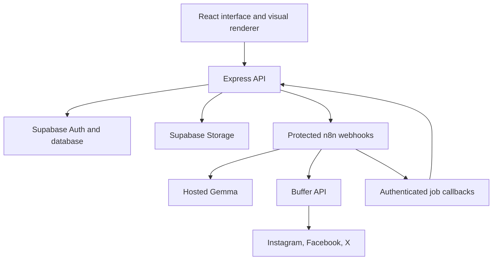

# FlowToFeed

Turn technical Markdown into editable [Mermaid](https://mermaid.js.org) diagrams and channel-specific visual lessons, ready to review and share.

FlowToFeed is a single-owner content studio: paste a technical explanation once, generate architecture/flowchart/sequence diagrams, adapt the explanation into Instagram carousel lessons, Facebook cards, and X threads, then review and publish everything through Buffer.

> This is the source code for a [Hacktoberfest Open-Source AI Challenge Week 3](https://dev.to/challenges/hacktoberfest-week3-2026-10-19) submission.

## Architecture



| Component | Technology | Responsibility |
| --- | --- | --- |
| Frontend | React, TypeScript, Vite | Input, diagram editor, previews, browser-side image rendering |
| API | Node.js, Express, TypeScript | Auth, ownership, jobs, storage, protected n8n triggers |
| Automation | n8n Community Edition (self-hosted) | Generation and distribution workflows, bounded retries |
| AI | Gemma (Google hosted API) | Diagram source and educational adaptation |
| Diagrams | Mermaid + curated icon packs | Architecture, flowchart, sequence rendering |
| Data | Supabase (Postgres, Auth, Storage) | Projects, revisions, variants, jobs, assets |
| Distribution | Buffer GraphQL API | Draft, publish now, schedule, status |
| Hosting | Render | Application web service + n8n web service |

## Repository layout

| Path | Contents |
| --- | --- |
| `apps/web` | React/Vite application and rendering templates |
| `apps/api` | Express API, auth, jobs, storage, provider adapters |
| `packages/shared` | TypeScript contracts, validation, platform limits |
| `workflows` | Exported n8n generation/distribution JSON and setup notes |
| `prompts` | Versioned generation and repair prompt templates |
| `supabase/migrations` | Application schema and access policies |
| `examples` | Sample technical explanations (cache-aside, indexing, pub/sub) |
| `evidence` | Measured runs, screenshots, demo assets |
| `docs` | Architecture, local setup, deployment, submission notes |
| `Plans` | Phase-wise implementation plan and logs |

## Getting started

Prerequisites: Node.js >= 22, Docker Desktop, a Supabase project, a Google AI Studio key, and a Buffer account with connected channels. See `things-required.txt` (local, not committed) and `docs/local-setup.md`.

```bash
npm install

# local n8n (http://localhost:5678)
npm run compose:up

# backend (http://localhost:3000)
cp apps/api/.env.example apps/api/.env   # fill in your values
npm run dev:api

# frontend (http://localhost:5173)
npm run dev:web
```

## Documentation

- [`docs/architecture.md`](docs/architecture.md) — runtime architecture and responsibility boundaries
- [`docs/local-setup.md`](docs/local-setup.md) — local development walkthrough
- [`docs/deployment.md`](docs/deployment.md) — Render deployment (app + n8n)
- [`docs/submission.md`](docs/submission.md) — challenge checklist and evidence plan
- [`Plans/flow-to-feed/phase_wise_plan.md`](Plans/flow-to-feed/phase_wise_plan.md) — implementation plan with phase status

## License

[MIT](LICENSE)
