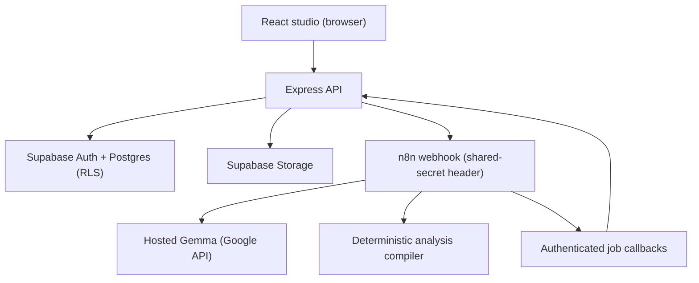

# FlowToFeed

Turn technical Markdown into editable [Mermaid](https://mermaid.js.org) diagrams and channel-specific visual lessons, ready to review and export.

FlowToFeed is a single-owner content studio: paste a technical explanation once, generate architecture, flowchart, or sequence diagrams from a highlighted passage, adapt the same passage into Instagram carousel lessons, Facebook cards, and X threads, then review, edit, and export channel-sized images to public URLs.


## Features

- **Passage-scoped diagram generation**: highlight one section of your source and generate an editable Mermaid diagram in three modes (architecture, flowchart, sequence), with labeled, color-coded edges and type-shaped nodes
- **Editor-first review**: edit the Mermaid source directly with live re-render, export SVG and PNG, one bounded AI repair if a render ever fails, approve when correct
- **Channel lessons**: the same passage becomes an Instagram carousel (caption plus slides), a Facebook explainer, and an X thread, each validated against its platform rules server-side (X posts use twitter-text weighted character counting)
- **Image export and hosting**: channel-sized cards (1080x1350 slides, 1200x1200, 1200x675) render in the browser, upload to Supabase Storage, and share public URLs
- **Source revisions**: every artifact remembers the source revision it came from; edit the source and older outputs are flagged stale
- **Inspectable automation**: the entire generation pipeline is one exported n8n workflow, every node readable in the repo

## Architecture



| Component | Technology | Responsibility |
| --- | --- | --- |
| Frontend | React, TypeScript, Vite | Input, diagram editor, previews, browser-side image rendering |
| API | Node.js, Express, TypeScript | Auth, ownership, jobs, storage, protected n8n triggers |
| Automation | n8n Community Edition | Generation workflow: prompt, Gemma call, compile, validate, bounded repair, idempotent callbacks |
| AI | Gemma (Google hosted API) | Analysis of the passage into a labeled-line contract |
| Diagrams | Mermaid | Editable, text-based diagram source |
| Data | Supabase (Postgres, Auth, Storage) | Projects, revisions, variants, jobs, assets |

## How generation works

1. The studio asks the API to generate. The API creates a job row, returns HTTP 202 with the job id, and fires the n8n webhook in the background.
2. The n8n workflow builds the prompt, calls Gemma, and passes the reply to a deterministic compiler.
3. Valid output becomes a diagram (or channel lesson) and flows back to the API through an authenticated, idempotent callback. Invalid output gets one bounded repair attempt, then a final callback either way.
4. The studio polls the job and renders the result.

The hosted Gemma model does not reliably emit JSON, so FlowToFeed never asks it to. Gemma analyzes the passage into labeled lines (`Title:` / `Components:` / `Flow 1 (label): A -> B` / `Assumptions:` / `Summary:`), and a deterministic, unit-tested compiler turns that analysis into valid Mermaid. The model does the thinking, code does the formatting. Every result records the model id and prompt version.

## Repository layout

| Path | Contents |
| --- | --- |
| `apps/web` | React/Vite application and rendering templates |
| `apps/api` | Express API, auth, jobs, storage, n8n trigger |
| `packages/shared` | TypeScript contracts, validation, platform limits |
| `workflows` | The exported n8n generation workflow, pure compiler modules, and the bundler that inlines them (`workflows/src`) |
| `prompts` | Versioned generation and repair prompt templates |
| `supabase/migrations` | Application schema and access policies |
| `examples` | Sample technical explanations (cache-aside) |
| `evidence` | Measured runs, screenshots, demo assets |
| `docs` | Architecture, setup, deployment, usage walkthrough |
| `Plans` | Phase-wise implementation plan and logs |

## Getting started (local)

Prerequisites: Node.js >= 22, Docker Desktop, a Supabase project, and a Google AI Studio key.

```bash
npm install

# local n8n (http://localhost:5678)
npm run compose:up

# backend (http://localhost:3000)
cp apps/api/.env.example apps/api/.env   # fill in your values
npm run dev:api

# frontend (http://localhost:5173)
npm run dev:web

# provision credentials + workflow into the local n8n container
npx tsx scripts/n8n-provision.ts
```

Then open `http://localhost:5173`, create an account, and follow the three-step studio: source, diagram, lessons. Full walkthrough with screenshots: [`docs/END_TO_END_GUIDE.md`](docs/END_TO_END_GUIDE.md).

## Tests and CI

- 25 unit tests cover the compilers, validation, jobs, and source revisions (`npm test`)
- GitHub Actions CI runs typecheck, build, and tests on every push and PR
- CodeQL security scanning on every push to dev and main
- Dependabot dependency PRs on a daily cadence, gated by CI

## Deployment

`render.yaml` defines the API (Node web service) and web (static site) with main-branch-only auto-deploy. The n8n worker runs as a Docker image service on Render with a persistent disk for `/home/node/.n8n` and a pinned `N8N_ENCRYPTION_KEY`. Deploys happen on merges to `main`; `dev` is the integration branch.

## Development note

The challenge submission was finalized at commit `f344f80`. After the deadline a few small follow-ups landed: minor fixes in the diagram compiler and workflow error path, small UI polish, and documentation. No core behavior changed.

## Documentation

- [`docs/END_TO_END_GUIDE.md`](docs/END_TO_END_GUIDE.md): complete end-to-end walkthrough (screenshots included)
- [`docs/architecture.md`](docs/architecture.md): runtime architecture and responsibility boundaries
- [`docs/local-setup.md`](docs/local-setup.md): local development walkthrough


## License

[MIT](LICENSE)
