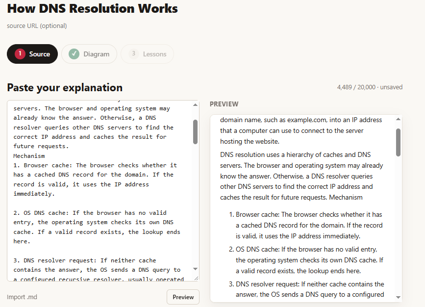
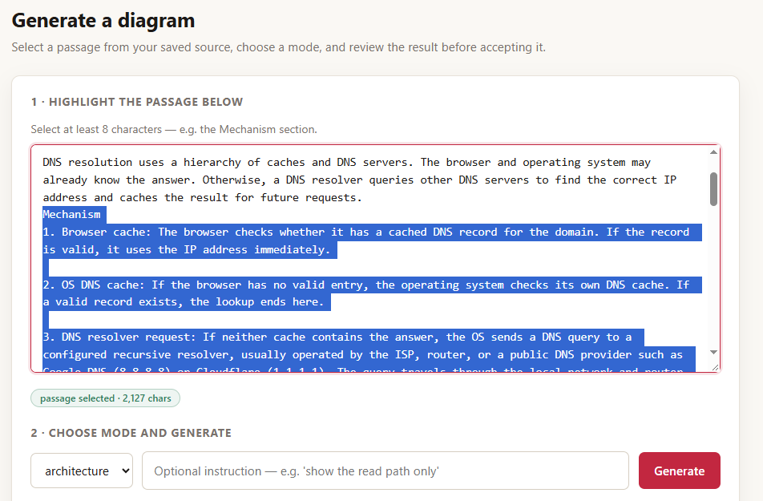
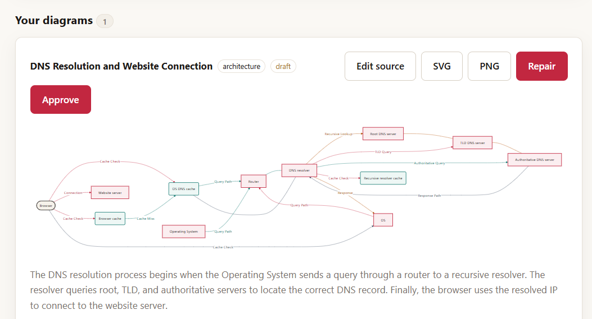
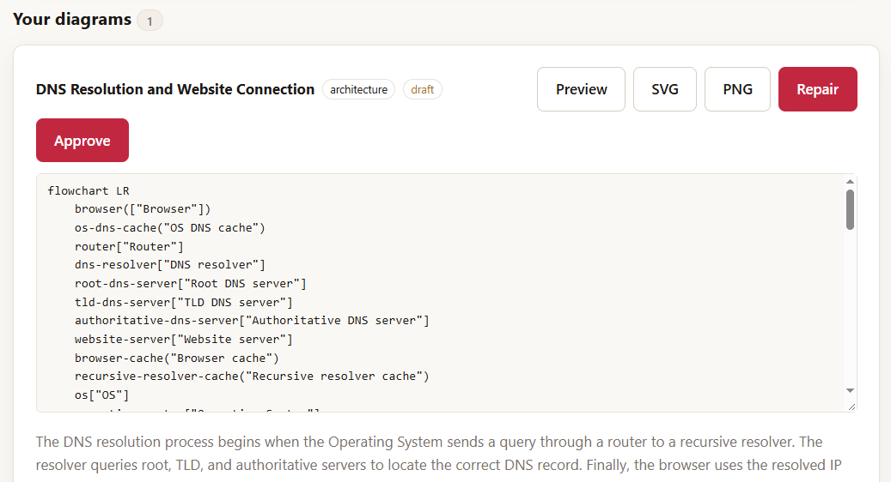

# FlowToFeed, end to end

This guide explains the whole system: what it does, how it is built, how every generation works under the hood, and how to run and use it. It is written for a developer seeing the project for the first time.

---

## 1. The problem it solves

If you write technical explanations, one piece of content turns into many. The blog post needs one diagram. The Instagram carousel needs the same idea redrawn at 1080x1350. The X thread needs it again at 1200x675, split into posts that fit strict character limits.

The thinking is done once. The rest is transcription: redrawing, resizing, rewriting, reformatting. FlowToFeed automates the transcription and leaves the judgment to you.

## 2. What the app does

The studio has three steps.

**Step 1, Source.** Paste a technical explanation in Markdown (or import a .md file). A live preview renders beside the editor. Save and continue.



**Step 2, Diagram.** Highlight one passage of your source (for example, the Mechanism section). Choose a mode: architecture, flowchart, or sequence. Optionally add an instruction such as "show the read path only". Click Generate, wait a few minutes, and an editable diagram appears.



The diagram is text (Mermaid), not pixels. Architecture mode produces a left-to-right flowchart with type-shaped nodes (cylinders for databases, rounded boxes for caches, stadiums for external actors) and edges labeled and color-coded per flow, so a cache-hit path and a cache-miss path are visibly different lines.



Because it is text, you can edit it. The "Edit source" view shows the Mermaid source with a live re-render. Export buttons produce SVG and PNG. If a diagram ever fails to render, one bounded AI repair is available.



**Step 3, Lessons.** The same passage is adapted into three channel lessons: an Instagram carousel (caption plus slides), a Facebook explainer (short paragraphs), and an X thread (3 to 5 posts). Each is a different structure, not one text cut three ways. X posts are counted with the real twitter-text weighted character algorithm, and the limit is enforced by the API, not just the UI. When a lesson is ready, "Generate images" renders channel-sized cards in your browser, uploads them, and shows public URLs you can hand to any scheduling tool.

Every artifact remembers which revision of the source it came from. Edit the source later and the studio flags older diagrams and lessons as stale instead of silently shipping outdated claims.

## 3. How it is built

Five pieces, each small on purpose:

| Piece | What it is |
| --- | --- |
| `apps/web` | React + Vite studio. Steps UI, Mermaid rendering, browser-side card export |
| `apps/api` | Express + TypeScript API. Auth, ownership, jobs, storage, the n8n trigger |
| `packages/shared` | Shared contracts and validation, including platform limits |
| `workflows` | One n8n workflow (exported JSON) plus the pure compiler modules it runs |
| Supabase | Postgres with row level security, Auth, Storage |

The pieces talk through one pattern: the **job and callback loop**.

1. The studio asks the API to generate something.
2. The API creates a `jobs` row (state `queued`), returns HTTP 202 with the job id immediately, and fires the n8n webhook in the background.
3. n8n runs the workflow and calls the API back at `/api/internal/jobs/:id/events` with a shared secret header.
4. The API applies the event, idempotently (every callback has a unique event id), and the studio polls the job until it is done.

This keeps the request path fast, makes the pipeline inspectable, and means a slow model call never blocks a browser request.

## 4. Inside the generation workflow

The n8n workflow (`workflows/generate.json`) is a straight line of nodes:

```
Webhook (header auth) -> 202 ack -> Prepare -> Gemma Generate -> Validate
    -> valid? -> Callback Success
              -> Repair Prompt -> Gemma Repair -> Validate Repair -> Callback Final
```

- **Prepare** builds the prompt from the passage, the mode, and your optional instruction.
- **Gemma Generate** calls the hosted Gemma model with an 8 minute timeout and 3 attempts.
- **Validate** runs the response through the deterministic compiler. Invalid output flows into one bounded repair attempt, then a final callback either way. If the Gemma call itself dies, the error flows into validation, which fails gracefully, and the final callback reports the failure. A failed job always ends as a visible "Generate again" in the UI, never a spinner that hangs forever.
- Every callback carries an idempotency key, so network retries cannot double-apply a result.

### The analysis and compile trick

The hosted Gemma model does not reliably emit JSON. Seven structured-output contracts were tried (JSON-only instructions, schema-first prompts, response mime types, assistant prefill, few-shot turns, a bigger model). All failed the same way: the replies came back as labeled planning bullets.

The bullets were actually good analysis. So the system was reshaped around that strength:

- Gemma analyzes the passage into labeled lines: `Title:`, `Components:`, `Flow 1 (label): A -> B`, `Assumptions:`, `Summary:`.
- A deterministic compiler (`workflows/src/analysis-compiler.js`, plain JavaScript, unit tested) converts that analysis into Mermaid. It filters model echoes (the model sometimes restates prompt rules as content), maps component types to node shapes, assigns one edge color per flow, deduplicates edges, and caps the diagram at 12 components for readability.

The model does the thinking, code does the formatting, and each side stays testable. Every generated result records the exact model id and prompt version.

## 5. Security and correctness boundaries

- n8n calls the API webhook with a shared secret header. n8n callbacks carry a second shared secret. Nothing trusts network proximity.
- Gemma output is untrusted input until it passes validation and compilation.
- Supabase row level security scopes every table to the owner. The public web key cannot read private projects.
- Platform rules (X weighted length, slide counts) are enforced server-side in the API and shared package.

## 6. Running it locally

Prerequisites: Node.js 22+, Docker Desktop, a Supabase project (URL plus publishable and secret keys), and a Google AI Studio key.

```bash
npm install

# 1. local n8n
npm run compose:up

# 2. fill apps/api/.env and root .env with your Supabase and Gemma keys
# 3. start the API and the web studio
npm run dev:api
npm run dev:web

# 4. provision secrets and the workflow into the local n8n container
npx tsx scripts/n8n-provision.ts
```

Then open `http://localhost:5173`, create an account, and follow the three steps above. The n8n console is at `http://localhost:5678` if you want to watch executions in real time.

## 7. Running it on Render

`render.yaml` defines two services, and the n8n worker runs as a third:

| Service | Type | Notes |
| --- | --- | --- |
| `flowtofeed-api` | Node web service | Health check at `/api/health`, builds the shared and api workspaces |
| `flowtofeed-web` | Static site | SPA rewrite fallback, `VITE_API_URL` baked at build time |
| `flowtofeed-n8n` | Docker image (`n8nio/n8n`) | Starter instance, persistent disk at `/home/node/.n8n`, pinned `N8N_ENCRYPTION_KEY` |

Deploys are main-branch only. Work happens on `dev`, and merging `dev` into `main` redeploys the API and web. The n8n workflow is updated by importing `workflows/render-import.local.json` (built from the source workflow with your secrets) and publishing it in the n8n UI.

## 8. What a generation costs in time

Measured on the cache-aside example (`evidence/measurements.md`):

- One diagram: about 2.5 to 6.5 minutes, unattended
- Three channel lessons: one serial pass, a few minutes each, unattended
- The manual baseline for the same package: roughly 45 to 60 minutes of redrawing, rewriting, and resizing

The review is the part worth a human: checking the mechanism is right, the caveat survived, and the example teaches.

## 9. Where the project is going

- Buffer distribution (draft, schedule, publish) is planned but not implemented; the studio currently ends at export and hosted image URLs
- More diagram modes (ER, state) fit the same analysis-compile pattern
- Public read-only sample projects for shareable demos

## 10. Repository tour

| Path | Read this for |
| --- | --- |
| `workflows/src/analysis-compiler.js` | The deterministic analysis-to-Mermaid compiler |
| `workflows/generate.json` | The full n8n workflow, every node readable |
| `packages/shared/src/social.ts` | Platform rules, including twitter-text weighted counting |
| `apps/api/src/services/jobs.ts` and `routes/internal.ts` | The job and callback loop |
| `prompts/` | Versioned prompt templates with rationale |
| `evidence/measurements.md` | The measured runs behind the numbers above |
