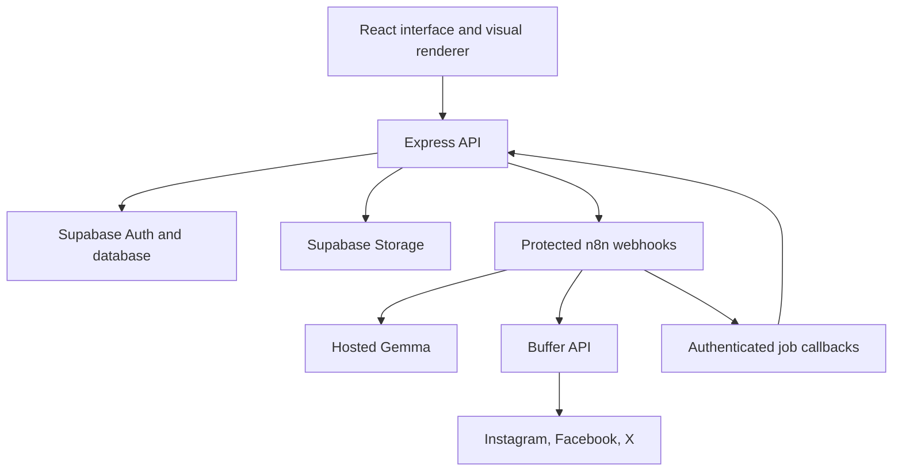

# Architecture

## Responsibilities

The system separates three concerns deliberately:

1. **The application owns the truth.** Source explanations, revisions, diagrams, variants, jobs, and distribution attempts live in Supabase Postgres, written only by the Express API. Provider IDs (Buffer) attach external delivery state; the application record stays authoritative.
2. **n8n is a stateless automation engine.** It receives authenticated webhooks, calls Gemma or Buffer with bounded retries, and reports back through authenticated callbacks. It keeps no business data beyond its own workflow definitions and credentials.
3. **The browser does the heavy rendering.** Mermaid rendering and social-image export run client-side so the hosted n8n instance stays small and cheap.

## Runtime flow

In production the Express service also serves the built frontend, keeping web and API on one origin.

## Key boundaries

| Boundary | Rule |
| --- | --- |
| Auth | Supabase Auth issues sessions; the API enforces `owner_id` checks on every project-scoped resource. Public sample project is read-only. |
| Secrets | Gemma/Buffer keys live in n8n credentials or server env. The browser never sees a provider key. |
| Jobs | Generation requests return `202` with a job id immediately; the UI polls `GET /api/jobs/:id` with backoff. |
| Callbacks | n8n calls `POST /api/internal/jobs/:id/events` with a shared secret; events are idempotent by `eventId`. |
| Distribution | Approved variant revisions are frozen into snapshots with an application-generated idempotency key before any Buffer call. A duplicate click returns the existing attempt. |
| Model output | Everything Gemma returns is untrusted input, validated with Zod even when the provider offers schema controls. |
| Publishing states | `draft`, `submitting`, `scheduled`, `published`, `failed`, `needs_verification`. "Published" is shown only after provider confirmation. |

## Diagram pipeline

1. Owner selects a passage and a mode (`architecture`, `flowchart`, `sequence`).
2. The API records a job and triggers the n8n generation webhook with the passage plus surrounding context.
3. n8n builds the prompt from a versioned template, calls Gemma, validates the structured response, and calls back with the result.
4. The browser renders the Mermaid source with the same registered icon pack used for export.
5. A failed render keeps the draft, shows the parser error, and offers one bounded AI repair job.

## Data model (minimum)

| Entity | Key fields |
| --- | --- |
| `projects` | id, owner_id, title, source_markdown, source_url, source_revision/hash, timestamps |
| `diagrams` | project_id, mode, source text, source_revision, mermaid code, explanation, assumptions, icon ids, review/render state |
| `variants` | project_id, platform, source_revision, diagram refs, revision, structured content, approved snapshot/hash |
| `assets` | project_id, variant/diagram ref, revision, storage path, public URL, width, height, MIME, hash, slide index |
| `jobs` | project_id, operation, state, stage, attempts, result refs, error, model/usage metadata |
| `distribution_attempts` | variant revision, platform, channel id, action, scheduled UTC time, idempotency key, state, Buffer id/URL, error |

## Trade-offs

- **Browser rendering** keeps server costs down but requires fonts and icon packs bundled for consistent export.
- **Self-hosted n8n** satisfies the visible-workflow requirement and makes automation auditable, at the cost of one more Render service with a persistent disk.
- **Hosted Gemma** avoids local GPU requirements; source content is sent to the provider, which the write-up discloses.
